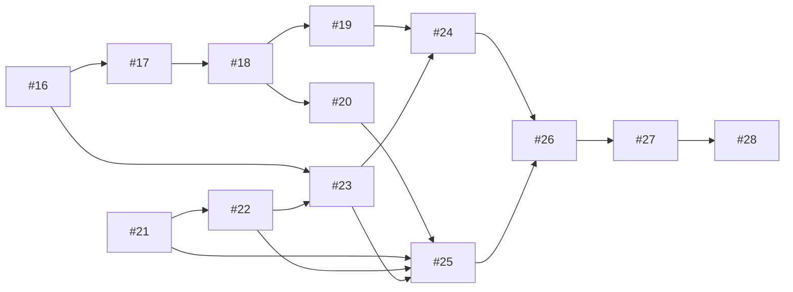

# P2実装計画

## 目的と管理方針

P2では、平均・分散・標準偏差の解説、コード描画、演習、誤答からの復習、学習記録をつなぐ縦断MVPを完成させる。教材registryと既存P1の6画面・QuestionInstance・localStorage v1を使い、機能ごとにレビュー可能なPRへ分ける。

この文書をP2の受入ゲート、PR分割、依存関係、未解決事項を管理する正本とする。発行済みIssueの受入条件を置き換えず、Issue #28の13 PR分割と実行順に一致させる。Issue #15の作業用handoff整理は独立しており、P2の依存ではない。

P2はQC検定2級全範囲の完成や合格可能性を保証しない。全教材執筆、公式問題転載、クラウド保存、PWA保証、学習者追跡は行わない。図はコード描画とし、学習・採点・進捗保存はブラウザ内で完結させる。

## 受入ゲート

各ゲートの実装順は次節の依存関係に従う。ゲート番号は機能範囲を示し、完了順を示さない。

| ゲート | Issue | 受入範囲 |
|---|---|---|
| G0 教材契約 | [#16](https://github.com/painkiller8880888/SfQC/issues/16) | planned/included教材契約、教材版とregistry版、宣言section、本文・図・出典参照、共通・条件付き前提、任意復習、DAG循環、revisionを検査しCIへ接続する。前提マップと公式対応表のID・前提・出典位置も照合する。現在の34単元はplannedとして登録し、未収録本文や学習者向けリンクを作らない。 |
| G1 教材と図 | [#17](https://github.com/painkiller8880888/SfQC/issues/17)、[#18](https://github.com/painkiller8880888/SfQC/issues/18)、[#19](https://github.com/painkiller8880888/SfQC/issues/19) | 数学・データ型の復習教材から平均・偏差・分散・標準偏差へ進み、独立検算済みのコード描画SVGを追加する。教材ID、出典、節リンク、alt text、キーボード操作を確認する。 |
| G2 問題と採点 | [#20](https://github.com/painkiller8880888/SfQC/issues/20)、[#21](https://github.com/painkiller8880888/SfQC/issues/21) | 固定・seed再現可能な生成問題、独立した出題snapshot、単一選択・数値採点、既知誤答と原因不明の誤答を区別するfeedbackを受け入れる。 |
| G3 学習導線と復習復帰 | [#23](https://github.com/painkiller8880888/SfQC/issues/23)〜[#26](https://github.com/painkiller8880888/SfQC/issues/26) | ID付きURLと状態保持、教材表示、出題・回答、feedback、Σを含む複数前提の復習、元の同一出題への復帰をつなぐ。 |
| G4 学習記録と進捗 | [#22](https://github.com/painkiller8880888/SfQC/issues/22)、[#27](https://github.com/painkiller8880888/SfQC/issues/27) | 解答試行・復習イベントを保存し、reloadとJSON export/importを越えて保持する。履歴に基づく進捗を根拠とともに表示する。 |
| G5 統合受入 | [#28](https://github.com/painkiller8880888/SfQC/issues/28) | P2全機能をGitHub Pagesの`/SfQC/`で一続きに試験し、CI、画面・リンク・保存互換、狭い画面、キーボード、公開後の直接表示とreloadを確認する。未検証事項をPASSとしない。 |

## 13 PRの分割

| PR | Issue | 内容と依存 |
|---|---|---|
| 01 教材データ契約 | [#16](https://github.com/painkiller8880888/SfQC/issues/16) | 他の教材・参照機能の前提。registry、validator、CI、P2計画文書。 |
| 02 数学・データ型の復習教材 | [#17](https://github.com/painkiller8880888/SfQC/issues/17) | #16の契約を使い、共通前提と多段復習先を収録。 |
| 03 中心となる統計教材 | [#18](https://github.com/painkiller8880888/SfQC/issues/18) | #16・#17に依存。平均、偏差、分散、標準偏差を独立検算して収録。偏差節IDは前提マップへ正式宣言してからincludedにする。 |
| 04 コード描画図 | [#19](https://github.com/painkiller8880888/SfQC/issues/19) | #18に依存。偏差と分散を示すSVG、単位、代替説明、アクセシビリティ。 |
| 05 固定・生成問題 | [#20](https://github.com/painkiller8880888/SfQC/issues/20) | #18に依存。seed再現性、別問題、出題snapshot。 |
| 06 採点・feedback判定 | [#21](https://github.com/painkiller8880888/SfQC/issues/21) | P1のQuestionDefinition契約 #8から並行して開始できる。 |
| 07 解答・復習履歴の保存 | [#22](https://github.com/painkiller8880888/SfQC/issues/22) | P1の保存v1 #9を拡張し、#21の判定型と整合させる。 |
| 08 ID付きURL・多段復習stack | [#23](https://github.com/painkiller8880888/SfQC/issues/23) | #16・#22に依存し、元の出題、回答、表示位置を保つ。 |
| 09 学習マップ・解説UI | [#24](https://github.com/painkiller8880888/SfQC/issues/24) | #17・#18・#19・#23に依存。 |
| 10 出題・解答フォームUI | [#25](https://github.com/painkiller8880888/SfQC/issues/25) | #20・#21・#22・#23に依存。 |
| 11 feedbackと復習往復 | [#26](https://github.com/painkiller8880888/SfQC/issues/26) | #24・#25で教材、出題、復習を接続する。 |
| 12 進捗画面 | [#27](https://github.com/painkiller8880888/SfQC/issues/27) | #22・#26の記録を表示する。 |
| 13 E2E受入・公開QA | [#28](https://github.com/painkiller8880888/SfQC/issues/28) | #16〜#27を統合検査する。各部品のCI合格だけではP2完了としない。 |

## 実行順と依存関係

1. #16で教材契約を固定する。
2. #17と#21は並行できる。#21の判定型が固まったら#22を進める。
3. 教材は#17から#18へ進める。#16と#22を前提に#23を進める。
4. #18後に#19と#20を並行する。#19と#23の後に#24、#20・#21・#22・#23の後に#25を進める。
5. #24と#25の後に#26、その後#27を進める。
6. #16〜#27がそろってから#28で統合受入する。

図は主要依存を示す。各Issue本文の細かな前提と受入条件も適用する。

## 共通の確認事項と後続課題

- 必須前提、条件付き前提、任意復習を区別し、既存P0のlessonId・sectionIdと一致させる。`planned`の参照IDは、本文・問題・学習者向けリンクの実在を意味しない。
- 既存QuestionInstance snapshot、AnswerAttempt、生成規則版、seedを破壊しない。保存v1からv2へ移行するときは非空データを保持し、失敗時・未対応版では元データを残す。
- 図はコードから描き、式・単位・図の意味をテキストでも伝える。新しい外部通信、学習者追跡、生成画像は追加しない。
- 公式出題範囲すべてをまだ収録しない。前提マップが保留・対象外とする信頼性工学SRC-0056〜0059、計測項目SRC-0060〜0061、測定誤差SRC-0064などは、範囲と教材深度を別途決める。
- 習熟度の推定、復習間隔の最適化、QC検定2級の合格確率の推定はP2に含めず、根拠のある記録・表示の後にP3以降で検討する。PWAとクラウドアカウントも対象外。
- P2の完了判断は#28で行う。平均・分散・標準偏差の独立検算、学習ループの往復、同一出題と別seed出題の区別、保存互換、CIと公開Pagesでの実地確認を記録する。

## G5 統合受入の検証記録（PR #42提出時点・2026-10-27）

[Issue #28](https://github.com/painkiller8880888/SfQC/issues/28)の受入に向けたPR [#42](https://github.com/painkiller8880888/SfQC/pull/42)の提出時点の記録。ローカルの自動検査とproduction previewでは学習ループを確認した。mainへのmerge、Pages deploy、公開URLのasset照合・公開ブラウザー検証は未実施であり、G5とP2は完了していない。Issue #28はopenのままとする。

| 確認 | 結果 | 根拠・境界 |
|---|---|---|
| 自動検査・production build | PASS | `npm run build`（`npm run check`、型検査、Node.jsテスト97件、本番build、出力検査を含む）。依存関係はlockfileどおりに`npm ci`で導入した。 |
| 横断アプリテスト | PASS | `node --test scripts/practice-app.test.mjs` 7件。異なるjsdom保存領域でJSON export/importの往復を含む。 |
| ローカルproduction preview | PASS | Vivaldi / Windowsで`/SfQC/`を開き、学習マップ→分散解説・SVG→固定数値問題→誤答feedback→Σの任意復習→復習stackで同じfeedbackへ戻る→同じ出題に正答、を実操作した。同じ出題IDと入力値1.030の保持、正答1.013を確認。公開Pagesの証拠には数えない。 |
| 進捗・reload | PASS | 誤答・正答の2試行、正答割合1/2（50.0%）、誤答候補と復習訪問を画面で確認。reload後も出題snapshot 1件、解答試行2件、復習イベント2件が残った。 |
| 狭い表示幅・キーボード | 部分確認 | ブラウザー400% zoom（約322 CSS px相当）でページ幅に合わせて表示され、TabでJSON書出しボタンへフォーカスできた。正確な320px viewportは未計測。 |
| ブラウザーUIからのJSON file操作 | 未確認 | production previewのデータ管理画面に書出し・読込み操作があることを確認。ファイルの実ダウンロードとfile pickerによる読込みは操作していない。JSONの内容保持と別保存先への復元は横断アプリテストで検査した。 |
| 公開GitHub Pages | 未確認（merge後） | QA対象merge SHAを含む最新成功deploy runとPages artifactを照合し、公開HTML・assetのURL/status/SHA-256、hash付き直アクセス・reload・主要ブラウザー操作を実測する。結果と未確認範囲はIssue #28とPR #42に追記する。 |

仕様上の未収録範囲、保存・オフラインの保証境界とP3への習熟度・復習スケジューラ引継ぎは、上記「共通の確認事項と後続課題」に従う。公開QAが完了し受入証拠をIssue #28へ記録するまで、PASSとして扱わない。
